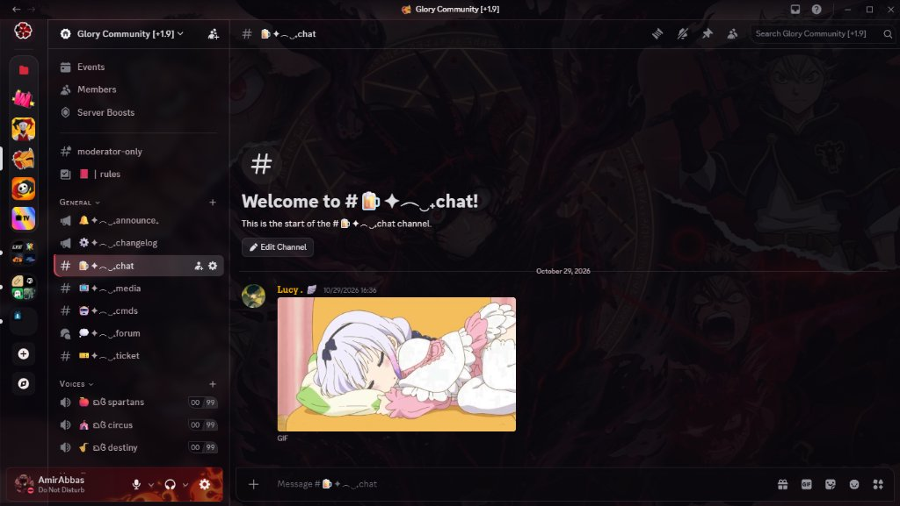

# Black Asta — BetterDiscord Theme & Companion Plugin

A **Black Clover (Anti-Magic)** inspired BetterDiscord theme featuring liquid-glass panels, blade-cut buttons, glowing status auras, floating embers, and an optional companion plugin with live customization, browser-style zoom, and automatic GitHub update checks.

---

## Preview

Default Wallpaper Artwork

---

## Features

### Theme (`BC_Asta.theme.css` v1.8.1)
- **Standalone Ready:** Works completely on its own without requiring any external plugin.
- **Liquid-Glass UI:** Frosted, tinted sidebars, headers, and settings panes with subtle light-catching edges.
- **Status Aura & Native Mobile Badges:** Soft glowing status ring around member/DM avatars while keeping Discord's native status & mobile phone icons intact (no avatar loading glitches).
- **Anti-Magic Effects:**
  - **Floating Embers:** Subtle rising crimson/gold embers over the wallpaper.
  - **Blade-Cut Hover Slash:** A quick diagonal slash of light across buttons, server icons, and tabs.
  - **Dispel Field:** Optionally hides flashy avatar decorations, nameplates, and profile effects.
  - **Mention Slash & Edge Wave:** Highlights new mentions with a crimson slash (and edge wave when paired with the companion plugin).
- **Auto-Update Support:** Includes `@updateUrl` for BetterDiscord's built-in updater.

### Companion Plugin (`BlackAstaCompanion.plugin.js` v1.4.0)
- **Live Palette Switcher:** Switch between **Anti-Magic** (Crimson), **Wind** (Green), **Water** (Blue), **Fire** (Orange), **Lightning** (Gold), and **Dark** (Violet) instantly.
- **Home Button Icon:** Choose between Black Clover artwork, Drawn Gold Clover, Magic Circle, or default Discord logo.
- **Wallpaper Source:** Switch between **GitHub (Default)**, **uupload Mirror**, or any **Custom HTTPS URL**.
- **Browser-Style Zoom:** Hold `Ctrl` + Mouse Wheel (or `Ctrl` + `+` / `-` / `0`) to zoom the Discord UI between `60%` and `180%` with a floating percentage HUD.
- **Helpers:** Automatically colours server member-list role headers to match role colours and tags the window title bar.
- **Glass Tuning:** Real-time sliders for panel opacity, glass blur, and wallpaper dimming.
- **GitHub Update Checker:** Automatically checks GitHub Releases for new versions (plus a manual **Check for updates** button in settings).

---

## Installation

### Quick Install (from Releases)
1. Download the latest `BC_Asta.theme.css` and *(optionally)* `BlackAstaCompanion.plugin.js` from the [**Releases page**](https://github.com/AmirAbbas8585/Black-Asta-BetterDiscord/releases).
2. Open Discord **Settings → BetterDiscord → Themes** → click **Open Themes Folder** and drop `BC_Asta.theme.css` inside.
3. *(Optional)* Open **Settings → BetterDiscord → Plugins** → click **Open Plugins Folder** and drop `BlackAstaCompanion.plugin.js` inside.
4. Enable **Black Asta** in Themes (and **BlackAstaCompanion** in Plugins).

### Direct Raw Links
- **Theme:** [`BC_Asta.theme.css`](https://raw.githubusercontent.com/AmirAbbas8585/Black-Asta-BetterDiscord/main/BC_Asta.theme.css)
- **Plugin:** [`BlackAstaCompanion.plugin.js`](https://raw.githubusercontent.com/AmirAbbas8585/Black-Asta-BetterDiscord/main/BlackAstaCompanion.plugin.js)

---

## Shortcuts (with Companion Plugin)

| Shortcut | Action |
| :--- | :--- |
| `Ctrl` + `Scroll Up` / `Scroll Down` | Zoom in / out (`60%` – `180%`) |
| `Ctrl` + `+` / `Ctrl` + `-` | Zoom in / out by `5%` |
| `Ctrl` + `0` | Reset zoom to `100%` |

---

## Author

- **amirabbas2556** — GitHub: [@AmirAbbas8585](https://github.com/AmirAbbas8585)

## License

Licensed under the [MIT License](LICENSE).
