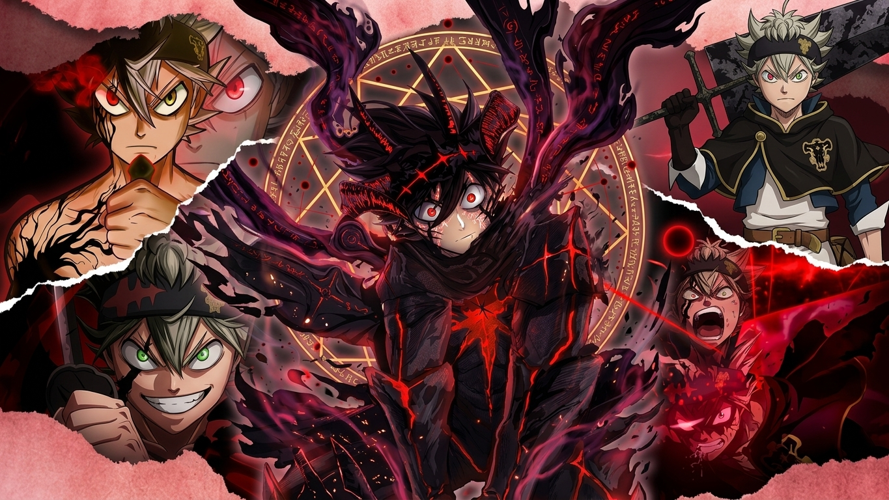

# Black Asta — BetterDiscord Theme & Companion Plugin

A **Black Clover** (Anti-Magic) inspired BetterDiscord theme featuring liquid-glass panels, blade-cut buttons, status stripes, floating embers, and an optional companion plugin with live customization.

## Included Files

- **`BC_Asta.theme.css`** — Standalone BetterDiscord theme (works on its own without any plugin).
- **`BlackAstaCompanion.plugin.js`** — Optional companion plugin that adds:
  - Live **Palette** switcher (`Anti-Magic`, `Wind`, `Water`, `Fire`, `Lightning`, `Dark`)
  - **Home button icon** selector (`Black Clover artwork`, `Drawn gold clover`, `Magic circle`, `Discord logo`)
  - **Wallpaper source** switcher (`GitHub Default`, `uupload Mirror`, or `Custom URL`)
  - **Effects toggles**: Floating embers, Anti-Magic hover slash, Anti-Magic field (dispel decorations), and Mention edge wave
  - **Helpers**: Server role title colouring & window title bar styling
  - **Glass controls**: Panel opacity, blur, and wallpaper dimming sliders

## Installation

1. Open Discord **Settings → BetterDiscord → Themes** (and **Plugins**).
2. Download [`BC_Asta.theme.css`](https://raw.githubusercontent.com/TV8569/Black-Asta-BetterDiscord/main/BC_Asta.theme.css) and place it in your BetterDiscord `themes` folder.
3. *(Optional)* Download [`BlackAstaCompanion.plugin.js`](https://raw.githubusercontent.com/TV8569/Black-Asta-BetterDiscord/main/BlackAstaCompanion.plugin.js) and place it in your BetterDiscord `plugins` folder.
4. Enable **Black Asta** in Themes (and **BlackAstaCompanion** in Plugins).

## Author

- **amirabbas2556** — GitHub: [@TV8569](https://github.com/TV8569)

## License

MIT License — see [LICENSE](LICENSE) for details.
